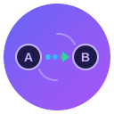

# AI-Relay

<p align="center">
  
</p>

<p align="center">
  <strong>Cross-Provider Context Continuity</strong><br>
  Seamlessly hand off AI coding sessions between Claude, Codex, Grok, and more.
</p>

<p align="center">
  <a href="#installation">Installation</a> •
  <a href="#quick-start">Quick Start</a> •
  <a href="#how-it-works">How It Works</a> •
  <a href="#supported-providers">Providers</a> •
  <a href="#roadmap">Roadmap</a>
</p>

---

## The Problem

You're deep in a coding session with Claude Code. You've made decisions, created files, established context. Then:

```
Error: Rate limit exceeded. Please try again later.
```

Now what? Copy-paste your conversation into Codex? Lose all that nuance? Start over?

## The Solution

AI-Relay captures your session context and seamlessly transfers it to the next available provider:

```bash
$ ai-relay start

[AI-Relay] Starting session rel_abc123
[AI-Relay] Selected: Claude Code (950/1000 msgs remaining)
[AI-Relay] Launching Claude Code...

# ... 45 minutes of productive work ...

[AI-Relay] Rate limit detected!
[AI-Relay] Capturing context... (12,847 tokens)
[AI-Relay] Handoff to Codex? [Y/n] y

[AI-Relay] Launching Codex CLI with context...

Codex: Continuing from your Claude session...
       You were refactoring auth to JWT.
       Ready to continue. What's next?
```

**Your context survives. Your momentum continues.**

---

## Installation

```bash
# Coming soon - currently in development
pip install ai-relay
```

## Quick Start

```bash
# Start a new relay session (picks best available provider)
ai-relay start

# Check provider status
ai-relay status

# Manual handoff to specific provider
ai-relay handoff codex

# Continue previous session
ai-relay continue
```

## How It Works

### Wrapper Mode (Automatic)

AI-Relay wraps your CLI, intercepting all I/O:

1. `ai-relay start` spawns Claude CLI as a subprocess
2. All conversation is logged in real-time
3. Rate limit detected → automatic context capture
4. Context compressed → injected into next provider
5. New CLI launches with full context

### Context Compression

Large conversations are intelligently compressed:

| Level | Tokens | Use Case |
|-------|--------|----------|
| Full | ~50K | Same provider resume |
| Standard | ~15K | Cross-provider handoff |
| Minimal | ~4K | Emergency handoff |
| Micro | ~1K | Quick continuation |

Uses Gemini Flash, Haiku, or local Ollama for fast/cheap summarization.

---

## Supported Providers

| Provider | Status | Notes |
|----------|--------|-------|
| Claude Code | Planned | Primary target |
| OpenAI Codex | Planned | Good code generation |
| Grok CLI | Planned | Real-time knowledge |
| Gemini | Planned | Free tier available |
| Ollama | Planned | Local fallback, no limits |

---

## VS Code Extension

<p align="center">
  
</p>

A standalone VS Code extension is planned (Phase 3):

```
+----------------------------------+
| AI-Relay                         |
+----------------------------------+
| Session: rel_abc123 (2h active)  |
| Context: 12.8K tokens            |
+----------------------------------+
| Providers              Status    |
|   [x] Claude Code      [====--]  |
|   [x] Codex CLI        [------]  |
|   [ ] Grok CLI         [==----]  |
+----------------------------------+
| [Start Session] [Handoff Now]    |
+----------------------------------+
```

---

## Roadmap

### Phase 1: Core CLI (MVP)
- [ ] SQLite session storage
- [ ] Claude + Codex adapters
- [ ] Manual capture/inject commands
- [ ] Basic compression

### Phase 2: Automatic Handoff
- [ ] Quota tracking
- [ ] Auto-detect rate limits
- [ ] AI-powered summarization
- [ ] Grok + Gemini adapters

### Phase 3: VS Code Extension
- [ ] Standalone sidebar
- [ ] Visual handoff controls
- [ ] Provider status indicators

### Phase 4: Advanced
- [ ] Ollama (local) adapter
- [ ] Cross-machine sync
- [ ] Team relay sessions
- [ ] Cost tracking

See [Issues](https://github.com/laurencelwarde/ai-relay/issues) for detailed task tracking.

---

## Configuration

```yaml
# ~/.ai-relay/config.yaml
providers:
  claude:
    priority: 1
    daily_limit: 1000
  codex:
    priority: 2
    daily_limit: null  # unlimited
  grok:
    priority: 3
    daily_limit: 500

compression:
  default_level: standard
  summarizer: gemini-flash
```

---

## Philosophy

> **Context is more valuable than any single provider.**

AI-Relay treats your conversation context as a portable asset. Providers come and go, quotas reset, subscriptions change - but your project understanding and decisions should persist.

---

## Contributing

Contributions welcome! See the [issues](https://github.com/laurencelwarde/ai-relay/issues) for planned features.

## License

MIT

---

<p align="center">
  <sub>Built for developers who refuse to lose context.</sub>
</p>
